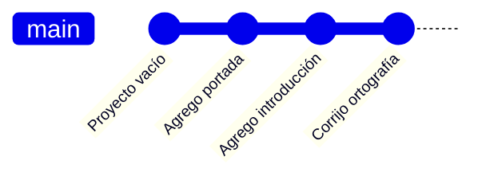

# 01 · ¿Qué es Git y qué es GitHub?

**Objetivo:** entender qué problema resuelven antes de tocar un solo comando.

## El problema

Seguro te ha pasado esto con una tarea:

```
reporte.docx
reporte_final.docx
reporte_final_ahora_si.docx
reporte_final_ahora_si_v2_corregido.docx
```

Ahora imagina lo mismo con un proyecto de 200 archivos y 4 personas editando al
mismo tiempo. Para eso existe el **control de versiones**.

## Git

**Git** es un programa que se instala en tu computadora y guarda el **historial**
de tu proyecto. Cada vez que le dices "guarda este momento", crea una foto
llamada **commit**. Puedes regresar a cualquier foto cuando quieras.



Cada punto es un commit: sabes **qué** cambió, **quién** lo cambió y **cuándo**.

## GitHub

**GitHub** es un sitio web donde subes tus proyectos de Git para:

- tener un **respaldo** en la nube,
- **compartir** tu código con otras personas,
- **trabajar en equipo** sin pisarse los cambios,
- armar tu **portafolio** (las empresas sí lo revisan).

## Git no es GitHub

| | Git | GitHub |
|---|---|---|
| ¿Qué es? | Un programa | Un sitio web |
| ¿Dónde vive? | En tu computadora | En internet |
| ¿Necesita internet? | No | Sí |
| ¿Para qué sirve? | Guardar el historial | Respaldar, compartir y colaborar |

> [!NOTE]
> Una comparación que ayuda: **Git es la cámara** que toma las fotos de tu
> proyecto y **GitHub es el álbum en línea** donde las subes y las compartes.

## Palabras que vas a escuchar mucho

| Palabra | Significado |
|---|---|
| **Repositorio (repo)** | La carpeta de tu proyecto junto con todo su historial |
| **Commit** | Una foto del proyecto en un momento dado |
| **Rama (branch)** | Una línea de trabajo paralela para probar cosas sin romper lo demás |
| **Remoto (remote)** | La copia del repo que vive en GitHub |
| **Push / Pull** | Subir tus commits a GitHub / bajar los commits nuevos |

## ✏️ Ejercicio

Contesta con tus palabras (en tu libreta o en voz alta con un compañero):

1. ¿Cuál es la diferencia entre Git y GitHub?
2. ¿Qué es un commit?
3. Menciona una situación de la escuela donde te habría servido un historial de cambios.

## ✅ Antes de continuar

- [ ] Puedo explicar qué es el control de versiones
- [ ] Sé que Git es el programa y GitHub es el sitio web
- [ ] Reconozco las palabras repo, commit, rama, push y pull

---

[🏠 Inicio](../README.md) · [Siguiente: 02 · Instalación ➡️](../02-instalacion/)
