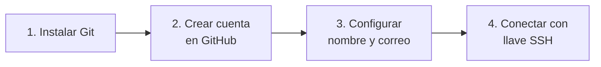

# 02 · Instalación y configuración

**Objetivo:** dejar tu computadora lista y conectada con tu cuenta de GitHub.



## 1. Instalar Git

**Windows**

1. Descarga el instalador desde <https://git-scm.com/downloads>.
2. Ejecútalo y deja las opciones que vienen por defecto (siguiente, siguiente, instalar).
3. Abre el programa **Git Bash** que se instaló. Ahí vas a escribir todos los comandos.

**Linux (Ubuntu / Debian)**

```bash
sudo apt update
sudo apt install git -y
```

**macOS**

```bash
xcode-select --install
```

**Comprueba que quedó instalado:**

```bash
git --version
```

Debe responder algo como `git version 2.x.x`.

## 2. Crear tu cuenta en GitHub

1. Entra a <https://github.com> y da clic en **Sign up**.
2. Usa un correo que revises seguido y elige un nombre de usuario serio
   (va a aparecer en tu portafolio).
3. Confirma tu correo.

## 3. Decirle a Git quién eres

Estos datos aparecen en cada commit que hagas. Cambia el nombre y el correo por los tuyos
(usa el mismo correo de tu cuenta de GitHub):

```bash
git config --global user.name "Tu Nombre"
git config --global user.email "tucorreo@ejemplo.com"
git config --global init.defaultBranch main
git config --global pull.rebase false
```

La última línea le dice a Git cómo unir cambios cuando haces `git pull`; sin ella,
las versiones nuevas de Git marcan error en el módulo 07.

Revisa que se guardaron:

```bash
git config --global --list
```

## 4. Conectar tu computadora con GitHub (SSH)

GitHub **no acepta tu contraseña** al subir código desde la terminal. La forma
más cómoda de identificarte es con una **llave SSH**: la configuras una vez y listo.

**a) Crea la llave** (cambia el correo por el tuyo). Cuando pregunte dónde
guardarla y por una contraseña, puedes dar Enter a todo:

```bash
ssh-keygen -t ed25519 -C "tucorreo@ejemplo.com"
```

**b) Muestra la llave pública y cópiala completa:**

```bash
cat ~/.ssh/id_ed25519.pub
```

**c) Pégala en GitHub:**

1. En GitHub, clic en tu foto (arriba a la derecha) → **Settings**.
2. Menú izquierdo → **SSH and GPG keys** → **New SSH key**.
3. Ponle un título (por ejemplo, "Mi laptop"), pega la llave y guarda.

**d) Prueba la conexión:**

```bash
ssh -T git@github.com
```

La primera vez pregunta si confías en el servidor: escribe `yes`. Si todo salió
bien verás un mensaje que empieza con `Hi tu-usuario!`.

> [!WARNING]
> Solo se comparte el archivo que termina en **`.pub`** (la llave pública).
> El otro archivo, `id_ed25519` sin extensión, es tu llave privada: nunca la
> pegues ni la subas a ningún lado.

> [!TIP]
> Si en tu red está bloqueado SSH, la alternativa es usar HTTPS con un
> *Personal Access Token*: en GitHub ve a **Settings → Developer settings →
> Personal access tokens** y usa ese token en lugar de la contraseña.

## 🖥️ Si usas una computadora compartida (laboratorio)

En el laboratorio varias personas usan la misma compu. Si no tienes cuidado,
vas a subir cambios **con la cuenta de otra persona** y el reto final no te va a contar.

**Antes de empezar:**
- En GitHub, revisa que el **avatar de arriba a la derecha sea el tuyo**. Si no, clic en el avatar → **Sign out** y entra con tu cuenta.
- En Git Bash, revisa que el nombre y el correo sean los tuyos:
  ```bash
  git config --global user.name
  git config --global user.email
  ```
  Si son de otra persona, vuelve a correr los comandos del paso 3 con tus datos.

**Al terminar, siempre:**
1. En GitHub: avatar → **Sign out**.
2. En Git Bash, borra tu sesión guardada (cambia `TU-USUARIO`):
   ```bash
   git credential-manager github logout TU-USUARIO
   ```

> [!TIP]
> Si el navegador te ofrece **traducir la página**, di que no. La traducción
> cambia los nombres de los botones y desacomoda las tablas del robot.

## ✏️ Ejercicio

Ejecuta estos tres comandos y verifica que los tres responden bien:

```bash
git --version
git config --global user.name
ssh -T git@github.com
```

## 🔎 Evidencia para el reto final

> [!IMPORTANT]
> Usa en `user.email` **el mismo correo de tu cuenta de GitHub**. Así GitHub liga
> tus commits a tu perfil, y eso es lo primero que revisa el reto final.

> [!TIP]
> **¿Ya quedó bien?** Haz `git push` y comenta `/revisar` en tu Issue de avance.
> Si todavía no lo tienes, ábrelo aquí: [📈 Revisar mi avance](https://github.com/git-master-utn/aprende-github/issues/new?template=revisar-avance.md&title=Revisar+mi+avance).

## ✅ Antes de continuar

- [ ] `git --version` muestra un número de versión
- [ ] Tengo cuenta en GitHub con mi correo confirmado
- [ ] Configuré mi nombre y mi correo en Git
- [ ] `ssh -T git@github.com` me saluda con mi usuario

---

[⬅️ Anterior: 01 · ¿Qué es Git?](../01-que-es-git/) · [🏠 Inicio](../README.md) · [Siguiente: 03 · Tu primer repositorio ➡️](../03-primer-repo/)
