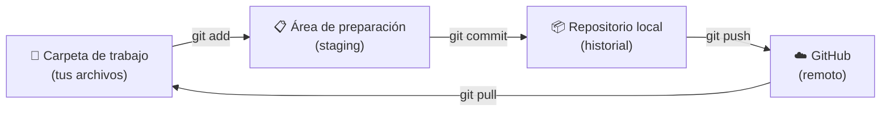

# 03 · Tu primer repositorio

**Objetivo:** crear un repo, guardar cambios y subirlos a GitHub.

## Las tres zonas de Git

Antes de los comandos, este dibujo es **lo más importante del curso**:



- **Carpeta de trabajo:** donde editas tus archivos normalmente.
- **Área de preparación:** donde eliges *qué cambios* van a entrar en la siguiente foto.
- **Repositorio local:** el historial de commits guardado en tu computadora.
- **GitHub:** la copia en la nube.

> [!NOTE]
> Piensa en una foto de grupo: con `git add` subes al escenario a quienes van a
> salir, con `git commit` tomas la foto y con `git push` la subes al álbum.

## Paso 1 · Crea la carpeta y el repo

```bash
mkdir mi-primer-repo
cd mi-primer-repo
git init
```

`git init` convierte la carpeta en un repositorio (crea una carpeta oculta `.git`).

## Paso 2 · Crea un archivo

```bash
echo "# Mi primer repositorio" > README.md
```

## Paso 3 · Revisa el estado

```bash
git status
```

Verás `README.md` en rojo como *untracked*: Git lo ve, pero todavía no lo sigue.

> [!TIP]
> `git status` es tu mejor amigo. Úsalo cada vez que no sepas qué está pasando.

## Paso 4 · Prepara el archivo

```bash
git add README.md
```

Vuelve a correr `git status`: ahora aparece en verde, listo para el commit.
Para preparar **todos** los cambios de un jalón se usa `git add .`

## Paso 5 · Haz tu primer commit

```bash
git commit -m "Agrego el README inicial"
```

El texto entre comillas es el **mensaje**: describe qué hiciste.

| ❌ Mensaje malo | ✅ Mensaje bueno |
|---|---|
| `cambios` | `Agrego la sección de instalación` |
| `asdf` | `Corrijo el enlace roto del menú` |
| `ya quedó` | `Actualizo la tabla de horarios` |

## Paso 6 · Mira el historial

```bash
git log --oneline
```

## Paso 7 · Crea el repo en GitHub

1. En GitHub, clic en el **+** de arriba a la derecha → **New repository**.
2. Nombre: `mi-primer-repo`.
3. Déjalo **Public** y **no marques** ninguna casilla (ni README, ni .gitignore, ni licencia).
4. Clic en **Create repository**.

## Paso 8 · Conecta y sube

Cambia `TU-USUARIO` por tu nombre de usuario de GitHub:

```bash
git remote add origin git@github.com:TU-USUARIO/mi-primer-repo.git
git branch -M main
git push -u origin main
```

Recarga la página de tu repo en GitHub: ahí está tu archivo. 🎉

A partir de ahora, el ciclo de todos los días es este:

```bash
git add .
git commit -m "Describe lo que hiciste"
git push
```

## ✏️ Ejercicio

1. Edita `README.md` y agrega una línea con tu nombre y tu carrera.
2. Crea un archivo nuevo llamado `notas.txt` con cualquier texto.
3. Haz **dos commits separados**, uno por cada cambio, con mensajes claros.
4. Súbelos con `git push` y comprueba en GitHub que aparecen los 3 commits.

## ✅ Antes de continuar

- [ ] Puedo explicar las tres zonas con mis palabras
- [ ] Sé usar `git status`, `git add`, `git commit` y `git push`
- [ ] Mi repo se ve en GitHub con sus commits

---

[⬅️ Anterior: 02 · Instalación](../02-instalacion/) · [🏠 Inicio](../README.md) · [Siguiente: 04 · Ramas ➡️](../04-ramas/)

Nombre: Yaretzi Paola Escobar Suarez 
Carrera: Ingeniería en Entornos Virtuales y Negocios Digitales

