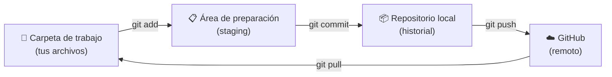

# 03 · Tu primer repositorio

**Objetivo:** crear un repo, guardar cambios y subirlos a GitHub.

## Las tres zonas de Git

Antes de los comandos, este dibujo es **lo más importante del curso**:



- **Carpeta de trabajo:** donde editas tus archivos normalmente.
- **Área de preparación:** donde eliges *qué cambios* van a entrar en la siguiente foto.
- **Repositorio local:** el historial de commits guardado en tu computadora.
- **GitHub:** la copia en la nube.

> [!NOTE]
> Piensa en una foto de grupo: con `git add` subes al escenario a quienes van a
> salir, con `git commit` tomas la foto y con `git push` la subes al álbum.

## Paso 1 · Crea la carpeta y el repo

💻 Abre **Git Bash** (menú Inicio → escribe *Git Bash* → Enter) y escribe estos
comandos uno por uno, presionando **Enter** después de cada uno:

```bash
cd ~/Downloads
mkdir mi-primer-repo
cd mi-primer-repo
git init
```

`git init` convierte la carpeta en un repositorio (crea una carpeta oculta `.git`).

✔️ Ahora la línea donde escribes termina en `~/Downloads/mi-primer-repo (master)`
o `(main)`. Ese texto entre paréntesis significa que **estás dentro de un repo**.
Tu carpeta también se ve en el Explorador de Windows, en **Descargas**.

> [!IMPORTANT]
> Desde aquí hasta el módulo 08, **todos** los comandos se escriben dentro de
> esta carpeta. Si cierras Git Bash, al abrirlo de nuevo escribe primero
> `cd ~/Downloads/mi-primer-repo`.

## Paso 2 · Crea un archivo

```bash
echo "# Mi primer repositorio" > README.md
```

## Paso 3 · Revisa el estado

```bash
git status
```

Verás `README.md` en rojo como *untracked*: Git lo ve, pero todavía no lo sigue.

> [!TIP]
> `git status` es tu mejor amigo. Úsalo cada vez que no sepas qué está pasando.

## Paso 4 · Prepara el archivo

```bash
git add README.md
```

Vuelve a correr `git status`: ahora aparece en verde, listo para el commit.
Para preparar **todos** los cambios de un jalón se usa `git add .`

## Paso 5 · Haz tu primer commit

```bash
git commit -m "Agrego el README inicial"
```

El texto entre comillas es el **mensaje**: describe qué hiciste.

| ❌ Mensaje malo | ✅ Mensaje bueno |
|---|---|
| `cambios` | `Agrego la sección de instalación` |
| `asdf` | `Corrijo el enlace roto del menú` |
| `ya quedó` | `Actualizo la tabla de horarios` |

## Paso 6 · Mira el historial

```bash
git log --oneline
```

## Paso 7 · Crea el repo en GitHub

🌐 Ahora en el navegador:

1. En GitHub, clic en el **+** de arriba a la derecha → **New repository**.
2. Nombre: **exactamente** `mi-primer-repo` (con ese nombre lo revisa el reto final).
3. Déjalo **Public** y **no marques** ninguna casilla (ni README, ni .gitignore, ni licencia).
4. Clic en **Create repository**.

## Paso 8 · Conecta y sube

💻 De regreso en Git Bash. Cambia `TU-USUARIO` por tu nombre de usuario de GitHub:

```bash
git remote add origin https://github.com/TU-USUARIO/mi-primer-repo.git
git branch -M main
git push -u origin main
```

La primera vez se abre una ventana para iniciar sesión: elige **Sign in with
your browser**, entra con **tu** cuenta y da clic en **Authorize**.

✔️ Git Bash termina con una línea parecida a `main -> main`. 🌐 Recarga la página
de tu repo en GitHub: ahí está tu archivo. 🎉

A partir de ahora, el ciclo de todos los días es este:

```bash
git add .
git commit -m "Describe lo que hiciste"
git push
```

## ✏️ Ejercicio

Todo esto se hace 💻 en Git Bash, dentro de `~/Downloads/mi-primer-repo`.

**1. Edita el README.** Ábrelo con el Bloc de notas:

```bash
notepad README.md
```

📝 Agrega una línea nueva con tu nombre y tu carrera, guarda con **Ctrl + S** y
cierra el Bloc de notas. Luego guarda la foto:

```bash
git add README.md
git commit -m "Agrego mi nombre y mi carrera al README"
```

**2. Crea un archivo nuevo** llamado `notas.txt`:

```bash
echo "Estas son mis notas del curso" > notas.txt
git add notas.txt
git commit -m "Agrego mis notas"
```

**3. Súbelo todo:**

```bash
git push
```

✔️ **Resultado esperado:** `git log --oneline` muestra **3 commits**, y 🌐 en la
página de tu repo aparecen `README.md` y `notas.txt` y dice **3 Commits**.

## 🔎 Evidencia para el reto final

> [!IMPORTANT]
> Tu `mi-primer-repo` debe ser **público**, tener `README.md` y al menos 3 commits.
> Vas a seguir usando este mismo repo en todos los módulos: no lo borres.

> [!TIP]
> **¿Ya quedó bien?** Haz `git push` y comenta `/revisar` en tu Issue de avance.
> Si todavía no lo tienes, ábrelo aquí: [📈 Revisar mi avance](https://github.com/git-master-utn/aprende-github/issues/new?template=revisar-avance.md&title=Revisar+mi+avance).

## ✅ Antes de continuar

- [ ] Puedo explicar las tres zonas con mis palabras
- [ ] Sé usar `git status`, `git add`, `git commit` y `git push`
- [ ] Mi repo se ve en GitHub con sus commits

---

[⬅️ Anterior: 02 · Instalación](../02-instalacion/) · [🏠 Inicio](../README.md) · [Siguiente: 04 · Ramas ➡️](../04-ramas/)
