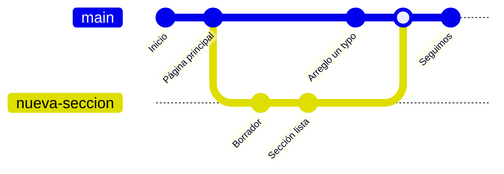
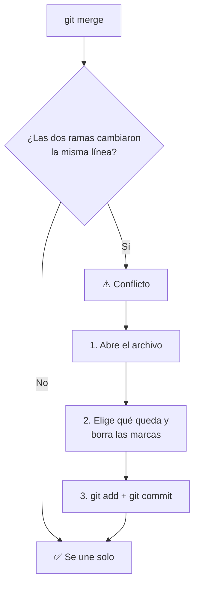

# 04 · Ramas

**Objetivo:** trabajar en paralelo sin romper lo que ya funciona.

## ¿Qué es una rama?

Una **rama** es una línea de trabajo separada. La rama principal se llama `main`
y ahí debe vivir la versión que **sí funciona**. Cuando quieres agregar o probar
algo, creas una rama, trabajas ahí y, cuando queda bien, la unes a `main`.



Si el experimento sale mal, borras la rama y `main` ni se enteró.

## Comandos de ramas

Trabaja dentro de tu carpeta `mi-primer-repo` del módulo anterior.

**Ver las ramas** (la que tiene `*` es donde estás parado):

```bash
git branch
```

**Crear una rama y cambiarte a ella:**

```bash
git switch -c nueva-seccion
```

**Haz un cambio y guárdalo en esa rama:**

```bash
echo "Esta línea nació en una rama" >> README.md
git add .
git commit -m "Agrego una línea desde la rama nueva-seccion"
```

**Regresa a main** y abre `README.md`: la línea nueva no está, porque vive en la otra rama.

```bash
git switch main
```

**Une la rama a main:**

```bash
git merge nueva-seccion
```

**Borra la rama que ya no necesitas y sube todo:**

```bash
git branch -d nueva-seccion
git push
```

## Conflictos: no son un error

Un **conflicto** aparece cuando dos ramas cambiaron **la misma línea** del mismo
archivo. Git no adivina cuál versión quieres, así que te pregunta.



Dentro del archivo, Git marca el conflicto así:

```text
<<<<<<< HEAD
Esta es la versión que está en main
=======
Esta es la versión que viene de la otra rama
>>>>>>> nueva-seccion
```

Para resolverlo:

1. Decide qué texto se queda (uno, el otro o una mezcla de los dos).
2. Borra las tres líneas de marcas (`<<<<<<<`, `=======` y `>>>>>>>`).
3. Guarda el archivo y termina la unión:

```bash
git add .
git commit -m "Resuelvo el conflicto del README"
```

> [!TIP]
> Si te arrepientes a medio conflicto, `git merge --abort` deja todo como
> estaba antes de empezar la unión.

## ✏️ Ejercicio: provoca un conflicto a propósito

1. Crea una rama y cambia **la primera línea** del README:
   ```bash
   git switch -c rama-a
   ```
   Edita la primera línea, guarda y haz commit.
2. Regresa a main y cambia **esa misma línea** por otro texto distinto:
   ```bash
   git switch main
   ```
   Edita, guarda y haz commit.
3. Intenta unirlas:
   ```bash
   git merge rama-a
   ```
4. Resuelve el conflicto siguiendo los pasos de arriba.

## ✅ Antes de continuar

- [ ] Sé crear una rama y moverme entre ramas
- [ ] Sé unir una rama con `git merge`
- [ ] Ya resolví al menos un conflicto

---

[⬅️ Anterior: 03 · Tu primer repositorio](../03-primer-repo/) · [🏠 Inicio](../README.md) · [Siguiente: 05 · Colaborar ➡️](../05-colaborar/)
