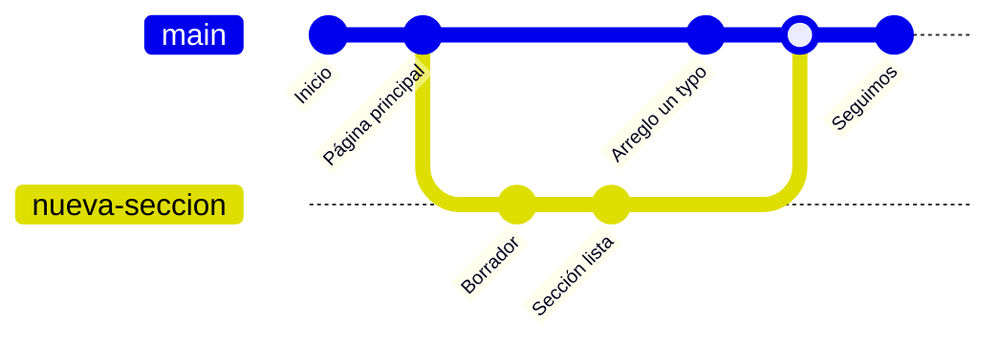
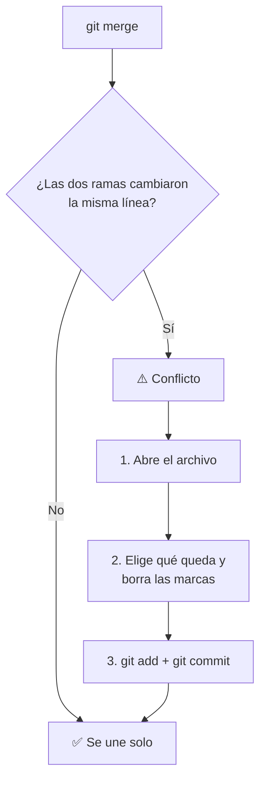

# 04 · Ramas

**Objetivo:** trabajar en paralelo sin romper lo que ya funciona.

## ¿Qué es una rama?

Una **rama** es una línea de trabajo separada. La rama principal se llama `main`
y ahí debe vivir la versión que **sí funciona**. Cuando quieres agregar o probar
algo, creas una rama, trabajas ahí y, cuando queda bien, la unes a `main`.



Si el experimento sale mal, borras la rama y `main` ni se enteró.

## Comandos de ramas

💻 Todo este módulo es en Git Bash, dentro de tu carpeta del módulo anterior:

```bash
cd ~/Downloads/mi-primer-repo
```

Lee esta parte para entender los comandos; el ejercicio de abajo es el que cuenta para el reto final.

**Ver las ramas** (la que tiene `*` es donde estás parado):

```bash
git branch
```

**Crear una rama y cambiarte a ella:**

```bash
git switch -c nueva-seccion
```

**Haz un cambio y guárdalo en esa rama:**

```bash
echo "Esta línea nació en una rama" >> README.md
git add .
git commit -m "Agrego una línea desde la rama nueva-seccion"
```

**Regresa a main** y revisa el README con `cat README.md`: la línea nueva no está, porque vive en la otra rama.

```bash
git switch main
```

**Une la rama a main:**

```bash
git merge nueva-seccion
```

**Borra la rama que ya no necesitas y sube todo:**

```bash
git branch -d nueva-seccion
git push
```

## Conflictos: no son un error

Un **conflicto** aparece cuando dos ramas cambiaron **la misma línea** del mismo
archivo. Git no adivina cuál versión quieres, así que te pregunta.



Dentro del archivo, Git marca el conflicto así:

```text
<<<<<<< HEAD
Esta es la versión que está en main
=======
Esta es la versión que viene de la otra rama
>>>>>>> nueva-seccion
```

Para resolverlo:

1. Abre el archivo con el conflicto: `notepad README.md`.
2. 📝 Decide qué texto se queda (uno, el otro o una mezcla de los dos).
3. Borra las tres líneas de marcas (`<<<<<<<`, `=======` y `>>>>>>>`).
4. Guarda con **Ctrl + S** y cierra el Bloc de notas.
5. 💻 Termina la unión:

```bash
git add README.md
git commit --no-edit
```

`--no-edit` guarda la unión con el mensaje automático `Merge branch 'rama-a'`,
y ese commit es justo la evidencia del reto final.

> [!TIP]
> Si te arrepientes a medio conflicto, `git merge --abort` deja todo como
> estaba antes de empezar la unión.

## ✏️ Ejercicio: provoca un conflicto a propósito

💻 En Git Bash, dentro de `~/Downloads/mi-primer-repo`. Sigue los pasos en orden.

**1. En una rama nueva, cambia la primera línea del README:**

```bash
git switch main
git switch -c rama-a
notepad README.md
```

📝 Cambia **la primera línea** por `# Versión de la rama A`, guarda (**Ctrl + S**) y cierra.

```bash
git commit -am "Cambio el título en rama-a"
```

**2. Regresa a main y cambia esa misma línea por otro texto:**

```bash
git switch main
notepad README.md
```

📝 Cambia **la primera línea** por `# Versión de main`, guarda y cierra.

```bash
git commit -am "Cambio el título en main"
```

**3. Une las ramas:**

```bash
git merge rama-a
```

✔️ Debe salir `CONFLICT (content): Merge conflict in README.md`. ¡Eso es lo que
buscábamos! La línea donde escribes ahora termina en `(main|MERGING)`.

**4. Resuelve el conflicto:**

```bash
notepad README.md
```

📝 Deja la primera línea como `# Mi primer repositorio`, borra las tres líneas de
marcas (`<<<<<<<`, `=======`, `>>>>>>>`), guarda y cierra.

```bash
git add README.md
git commit --no-edit
```

**5. Súbelo:**

```bash
git push
```

✔️ **Resultado esperado:** `git log --oneline` muestra arriba un commit
`Merge branch 'rama-a'`, y la línea donde escribes ya no dice `MERGING`.

## 🔎 Evidencia para el reto final

> [!IMPORTANT]
> Haz el ejercicio del conflicto en tu `mi-primer-repo` y súbelo con `git push`.
> El commit de la unión (`Merge branch 'rama-a'`) es la evidencia.

> [!TIP]
> **¿Ya quedó bien?** Haz `git push` y comenta `/revisar` en tu Issue de avance.
> Si todavía no lo tienes, ábrelo aquí: [📈 Revisar mi avance](https://github.com/git-master-utn/aprende-github/issues/new?template=revisar-avance.md&title=Revisar+mi+avance).

## ✅ Antes de continuar

- [ ] Sé crear una rama y moverme entre ramas
- [ ] Sé unir una rama con `git merge`
- [ ] Ya resolví al menos un conflicto

---

[⬅️ Anterior: 03 · Tu primer repositorio](../03-primer-repo/) · [🏠 Inicio](../README.md) · [Siguiente: 05 · Colaborar ➡️](../05-colaborar/)
