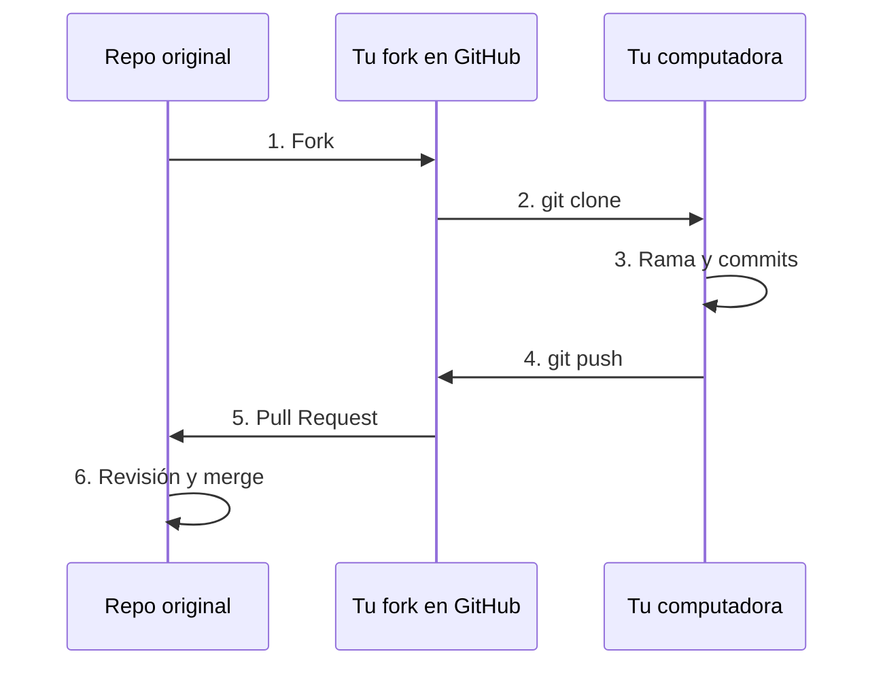

# 05 · Colaborar: fork, clone y Pull Request

**Objetivo:** aportar a un repositorio que no es tuyo, como se hace en el mundo real.

## La idea

No puedes escribir directo en el repo de otra persona. Lo que haces es:

1. Sacar **tu propia copia** en GitHub (**fork**).
2. Bajarla a tu computadora (**clone**).
3. Hacer tus cambios en una **rama**.
4. Subirlos a tu copia (**push**).
5. Pedirle al dueño que acepte tus cambios (**Pull Request**, o PR).



| Palabra | Significado |
|---|---|
| **Fork** | Tu copia personal de un repo ajeno, dentro de tu cuenta de GitHub |
| **Clone** | Descargar un repo de GitHub a tu computadora |
| **Pull Request** | Solicitud para que el dueño revise tus cambios y los una a su repo |

## Paso 1 · Haz fork

Entra al repositorio original en GitHub y da clic en el botón **Fork** (arriba a
la derecha) → **Create fork**. Ahora tienes una copia en `github.com/TU-USUARIO/...`

## Paso 2 · Clona tu fork

En la página de **tu fork**, clic en el botón verde **Code** → pestaña **SSH** →
copia la dirección. Luego:

```bash
git clone git@github.com:TU-USUARIO/NOMBRE-DEL-REPO.git
cd NOMBRE-DEL-REPO
```

## Paso 3 · Crea una rama para tu cambio

```bash
git switch -c mi-aporte
```

> [!WARNING]
> No trabajes directo en `main`. Una rama por cada aporte mantiene todo ordenado
> y es lo que se espera en cualquier proyecto.

## Paso 4 · Haz el cambio, commit y push

Edita lo que necesites y después:

```bash
git add .
git commit -m "Describe tu aporte"
git push -u origin mi-aporte
```

## Paso 5 · Abre el Pull Request

1. Entra a tu fork en GitHub. Aparece un aviso amarillo con el botón
   **Compare & pull request**: dale clic.
2. Escribe un **título claro** y una descripción corta de lo que cambiaste.
3. Clic en **Create pull request**.

## Paso 6 · Revisión

El dueño del repo puede:

- **Aceptarlo** (merge): tus cambios ya forman parte del proyecto. 🎉
- **Pedirte cambios**: haces más commits en la misma rama, vuelves a hacer
  `git push` y el PR se actualiza solo.

## Mantén tu fork al día

Con el tiempo el repo original recibe cambios que tu fork no tiene. Para
actualizarlo, entra a tu fork en GitHub y usa el botón **Sync fork**. Después,
en tu computadora:

```bash
git switch main
git pull
```

## Trabajo en equipo dentro del mismo repo

Si el dueño te agrega como **colaborador** (Settings → Collaborators), no
necesitas fork: clonas el repo directo, creas tu rama, haces push y abres el PR
desde ahí. El resto del flujo es igual.

## ✏️ Ejercicio

Practica con un compañero:

1. Haz fork del repo `mi-primer-repo` de tu compañero.
2. Clónalo, crea una rama y agrega una línea con un saludo en su README.
3. Mándale un Pull Request.
4. Tu compañero lo revisa y lo acepta. Luego cambian de papel.

## ✅ Antes de continuar

- [ ] Entiendo la diferencia entre fork y clone
- [ ] Ya abrí un Pull Request
- [ ] Ya acepté (o me aceptaron) un Pull Request

---

[⬅️ Anterior: 04 · Ramas](../04-ramas/) · [🏠 Inicio](../README.md) · [Siguiente: 06 · Extras ➡️](../06-extras/)
