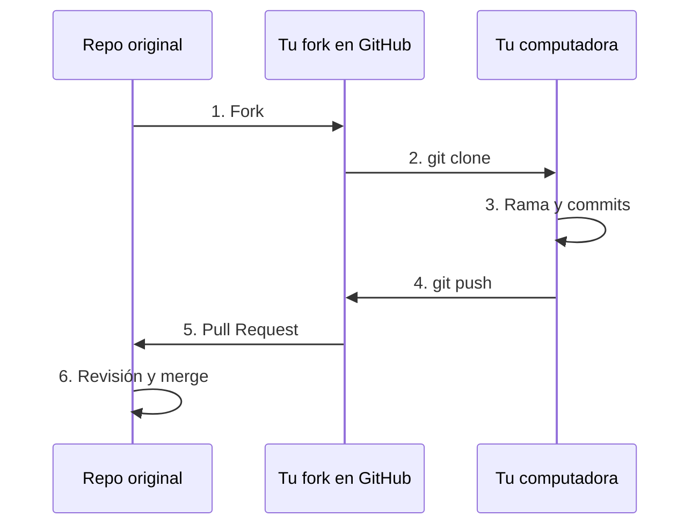

# 05 · Colaborar: fork, clone y Pull Request

**Objetivo:** aportar a un repositorio que no es tuyo, como se hace en el mundo real.

## La idea

No puedes escribir directo en el repo de otra persona. Lo que haces es:

1. Sacar **tu propia copia** en GitHub (**fork**).
2. Bajarla a tu computadora (**clone**).
3. Hacer tus cambios en una **rama**.
4. Subirlos a tu copia (**push**).
5. Pedirle al dueño que acepte tus cambios (**Pull Request**, o PR).



| Palabra | Significado |
|---|---|
| **Fork** | Tu copia personal de un repo ajeno, dentro de tu cuenta de GitHub |
| **Clone** | Descargar un repo de GitHub a tu computadora |
| **Pull Request** | Solicitud para que el dueño revise tus cambios y los una a su repo |

## Paso 1 · Haz fork

Entra al repositorio original en GitHub y da clic en el botón **Fork** (arriba a
la derecha) → **Create fork**. Ahora tienes una copia en `github.com/TU-USUARIO/...`

## Paso 2 · Clona tu fork

En la página de **tu fork**, clic en el botón verde **Code** → pestaña **HTTPS** →
copia la dirección. Luego, 💻 en Git Bash:

```bash
git clone https://github.com/TU-USUARIO/NOMBRE-DEL-REPO.git
cd NOMBRE-DEL-REPO
```

## Paso 3 · Crea una rama para tu cambio

```bash
git switch -c mi-aporte
```

> [!WARNING]
> No trabajes directo en `main`. Una rama por cada aporte mantiene todo ordenado
> y es lo que se espera en cualquier proyecto.

## Paso 4 · Haz el cambio, commit y push

Edita lo que necesites y después:

```bash
git add .
git commit -m "Describe tu aporte"
git push -u origin mi-aporte
```

## Paso 5 · Abre el Pull Request

1. Entra a tu fork en GitHub. Aparece un aviso amarillo con el botón
   **Compare & pull request**: dale clic.
2. Escribe un **título claro** y una descripción corta de lo que cambiaste.
3. Clic en **Create pull request**.

## Paso 6 · Revisión

El dueño del repo puede:

- **Aceptarlo** (merge): tus cambios ya forman parte del proyecto. 🎉
- **Pedirte cambios**: haces más commits en la misma rama, vuelves a hacer
  `git push` y el PR se actualiza solo.

## Mantén tu fork al día

Con el tiempo el repo original recibe cambios que tu fork no tiene. Para
actualizarlo, entra a tu fork en GitHub y usa el botón **Sync fork**. Después,
en tu computadora:

```bash
git switch main
git pull
```

## Trabajo en equipo dentro del mismo repo

Si el dueño te agrega como **colaborador** (Settings → Collaborators), no
necesitas fork: clonas el repo directo, creas tu rama, haces push y abres el PR
desde ahí. El resto del flujo es igual.

## ✏️ Ejercicio

Practica en parejas. Cada quien usa **su propia cuenta** (revisa el avatar).

**Tú le mandas un PR a tu compañero:**

1. Entra a `github.com/USUARIO-DE-TU-COMPAÑERO/mi-primer-repo`.
2. Clic en **Add file → Create new file**. GitHub te ofrece hacer un fork: acéptalo.
3. Nombre del archivo: `saludo-TU-USUARIO.txt`. Escribe un saludo adentro.
4. **Commit changes** → **Propose changes** → **Create pull request**.
5. Revisa que arriba del PR diga **into USUARIO-DE-TU-COMPAÑERO:main**. Si dice tu
   propio usuario, se fue a tu repo: lee *"Problemas comunes"* abajo.

**Tu compañero lo acepta** (con **su** cuenta): **Pull requests** → abre el PR →
**Merge pull request** → **Confirm merge**. Luego cambian de papel.

> [!TIP]
> Se crea un **archivo nuevo** con tu usuario en el nombre, en lugar de editar
> el README, para que los PRs de varios compañeros no choquen entre sí.

## 🧯 Problemas comunes

| Te pasa esto | Por qué | Solución |
|---|---|---|
| El PR se creó **en tu propio repo** | Ya tienes un repo llamado `mi-primer-repo`, así que tu fork se llamó `mi-primer-repo-1` y GitHub eligió mal el destino | Cierra ese PR. Entra a `github.com/USUARIO-DE-TU-COMPAÑERO/mi-primer-repo/compare` → **compare across forks** → **base repository:** el de tu compañero, **base:** `main`, **head repository:** tu fork, **compare:** tu rama → **Create pull request** |
| **This branch has conflicts** | Tú y el dueño cambiaron la misma línea del mismo archivo | Clic en **Resolve conflicts**, deja el texto correcto, borra las líneas `<<<<<<<`, `=======` y `>>>>>>>`, **Mark as resolved** → **Commit merge**. Si no te deja, que lo haga quien mandó el PR desde su cuenta |
| **Review required** y no se puede unir | El dueño protegió `main` pidiendo aprobaciones | El dueño (no quien mandó el PR) entra a **Files changed → Review changes → Approve**. Mejor aún: no marquen *Require approvals* (ve el [módulo 08](../08-permisos/)) |
| *"Pull request authors can't approve their own pull requests"* | Estás con la cuenta de quien mandó el PR | Cierra sesión y entra con la cuenta del **dueño** del repo |

## 🔎 Evidencia para el reto final

> [!IMPORTANT]
> En tu `mi-primer-repo` debe quedar **aceptado** al menos un Pull Request
> hecho por un compañero.

> [!TIP]
> **¿Ya quedó bien?** Haz `git push` y comenta `/revisar` en tu Issue de avance.
> Si todavía no lo tienes, ábrelo aquí: [📈 Revisar mi avance](https://github.com/git-master-utn/aprende-github/issues/new?template=revisar-avance.md&title=Revisar+mi+avance).

## ✅ Antes de continuar

- [ ] Entiendo la diferencia entre fork y clone
- [ ] Ya abrí un Pull Request
- [ ] Ya acepté (o me aceptaron) un Pull Request

---

[⬅️ Anterior: 04 · Ramas](../04-ramas/) · [🏠 Inicio](../README.md) · [Siguiente: 06 · Extras ➡️](../06-extras/)
