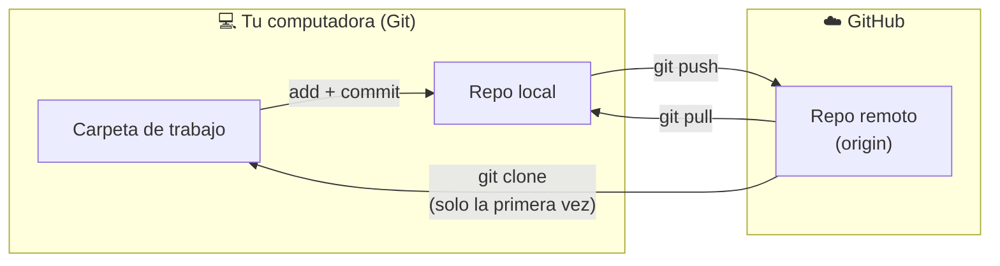
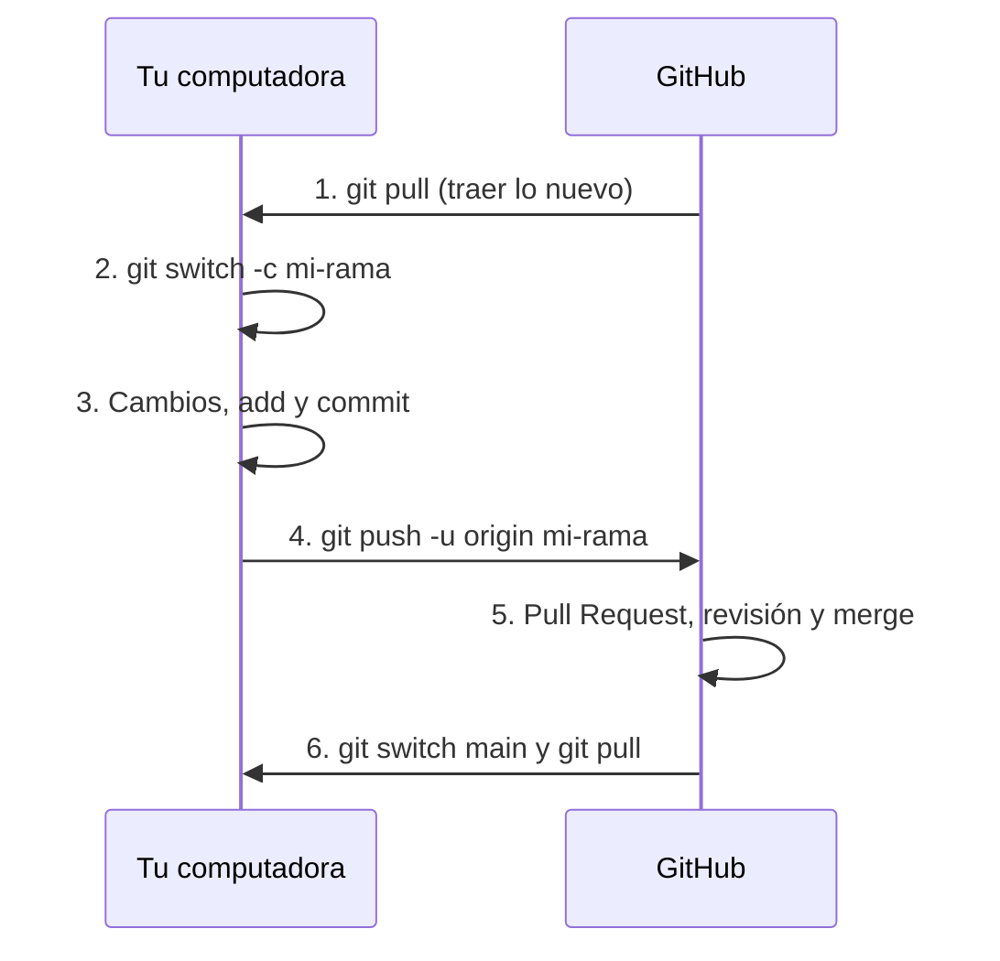

# 07 · Git y GitHub juntos

**Objetivo:** entender cómo se conectan tu computadora y GitHub, y juntar todo
lo aprendido en un solo flujo de trabajo.

## Dos copias del mismo repo

Cuando trabajas con Git y GitHub existen **dos copias** de tu repositorio:

- la **local**, en tu computadora, donde trabaja **Git**;
- la **remota**, en internet, que guarda **GitHub**.

No se sincronizan solas: **tú decides** cuándo subir y cuándo bajar cambios.



> [!NOTE]
> **`origin`** es solo el apodo que Git le pone a la dirección de tu repo en
> GitHub. Puedes verla con `git remote -v`.

## ¿Qué se hace en cada lado?

| Con Git, en tu computadora | Con GitHub, en el navegador |
|---|---|
| Crear y editar archivos | Crear el repo remoto |
| `git add` y `git commit` | Hacer fork de un repo ajeno |
| Crear y unir ramas | Abrir y revisar Pull Requests |
| Ver el historial con `git log` | Issues, Pages y configuración |
| Resolver conflictos | Invitar colaboradores y dar permisos |

Los comandos que **cruzan** de un lado al otro son solo cuatro:

| Comando | Dirección | Qué hace |
|---|:-:|---|
| `git clone` | ☁️ → 💻 | Copia un repo completo por primera vez |
| `git push` | 💻 → ☁️ | Sube tus commits |
| `git fetch` | ☁️ → 💻 | Descarga las novedades **sin** tocar tus archivos |
| `git pull` | ☁️ → 💻 | Descarga las novedades **y** las une a tu rama |

## Dos formas de empezar

**A) El repo ya existe en GitHub** (lo más común):

```bash
git clone git@github.com:TU-USUARIO/NOMBRE-DEL-REPO.git
```

`clone` ya deja conectado el remoto `origin`; no hay que configurarlo.

**B) El proyecto ya existe en tu computadora:**

```bash
git init
git add .
git commit -m "Primer commit"
git branch -M main
git remote add origin git@github.com:TU-USUARIO/NOMBRE-DEL-REPO.git
git push -u origin main
```

El `-u` se usa **solo la primera vez**: enlaza tu rama local con la remota para
que después baste con escribir `git push` y `git pull`.

## El flujo completo de un día de trabajo



En comandos:

```bash
git switch main
git pull
git switch -c mi-rama
# ...editas tus archivos...
git add .
git commit -m "Describe tu cambio"
git push -u origin mi-rama
```

Abres el Pull Request en GitHub y, cuando lo acepten:

```bash
git switch main
git pull
git branch -d mi-rama
```

> [!TIP]
> Regla de oro: **`git pull` antes de empezar, `git push` al terminar.**
> Así casi nunca tendrás conflictos.

## ¿Cómo sé si estoy sincronizado?

```bash
git fetch
git status
```

| `git status` dice... | Significa | Qué hacer |
|---|---|---|
| `up to date with 'origin/main'` | Estás al día | Nada |
| `ahead of 'origin/main' by 2 commits` | Tienes commits sin subir | `git push` |
| `behind 'origin/main' by 3 commits` | GitHub tiene commits que tú no | `git pull` |
| `have diverged` | Los dos lados tienen commits distintos | `git pull` y resolver conflictos si aparecen |

## El error más común: push rechazado

```text
! [rejected]        main -> main (fetch first)
```

Significa que en GitHub hay commits que tu computadora todavía no tiene (alguien
subió algo, o editaste un archivo desde la página web). Se arregla así:

```bash
git pull
git push
```

## ✏️ Ejercicio

1. En **GitHub**, abre `mi-primer-repo`, edita el README con el ícono del lápiz
   y guarda con **Commit changes**.
2. En tu **computadora**, sin hacer pull, edita otro archivo y haz commit.
3. Ejecuta `git fetch` y `git status`. ¿Qué te dice?
4. Intenta `git push` y observa el error.
5. Arréglalo con `git pull` y vuelve a subir.

## ✅ Antes de continuar

- [ ] Sé que hay una copia local y una remota, y que no se sincronizan solas
- [ ] Sé qué es `origin`
- [ ] Distingo `clone`, `push`, `fetch` y `pull`
- [ ] Sé arreglar un push rechazado

---

[⬅️ Anterior: 06 · Extras](../06-extras/) · [🏠 Inicio](../README.md) · [Siguiente: 08 · Permisos ➡️](../08-permisos/)
