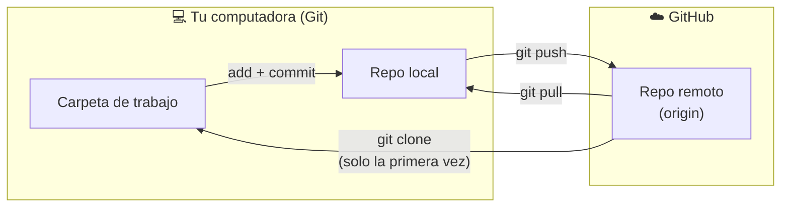
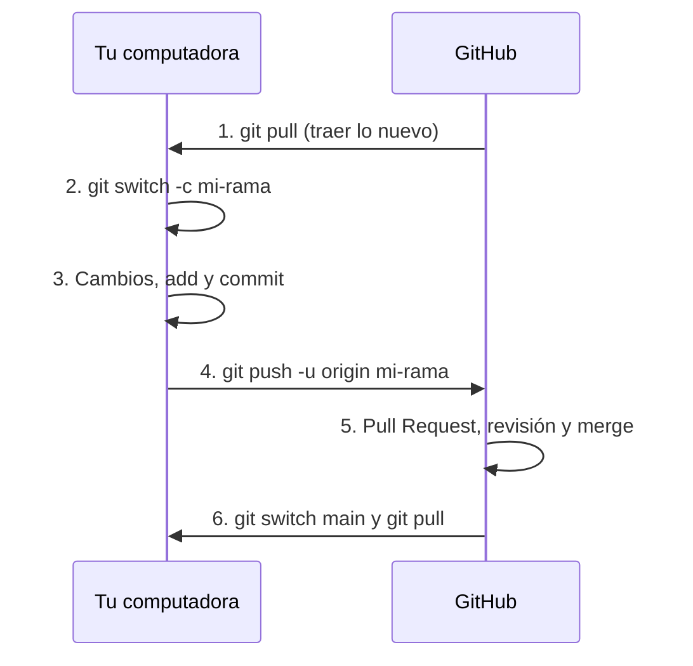

# 07 · Git y GitHub juntos

**Objetivo:** entender cómo se conectan tu computadora y GitHub, y juntar todo
lo aprendido en un solo flujo de trabajo.

## Dos copias del mismo repo

Cuando trabajas con Git y GitHub existen **dos copias** de tu repositorio:

- la **local**, en tu computadora, donde trabaja **Git**;
- la **remota**, en internet, que guarda **GitHub**.

No se sincronizan solas: **tú decides** cuándo subir y cuándo bajar cambios.



> [!NOTE]
> **`origin`** es solo el apodo que Git le pone a la dirección de tu repo en
> GitHub. Puedes verla con `git remote -v`.

## ¿Qué se hace en cada lado?

| Con Git, en tu computadora | Con GitHub, en el navegador |
|---|---|
| Crear y editar archivos | Crear el repo remoto |
| `git add` y `git commit` | Hacer fork de un repo ajeno |
| Crear y unir ramas | Abrir y revisar Pull Requests |
| Ver el historial con `git log` | Issues, Pages y configuración |
| Resolver conflictos | Invitar colaboradores y dar permisos |

Los comandos que **cruzan** de un lado al otro son solo cuatro:

| Comando | Dirección | Qué hace |
|---|:-:|---|
| `git clone` | ☁️ → 💻 | Copia un repo completo por primera vez |
| `git push` | 💻 → ☁️ | Sube tus commits |
| `git fetch` | ☁️ → 💻 | Descarga las novedades **sin** tocar tus archivos |
| `git pull` | ☁️ → 💻 | Descarga las novedades **y** las une a tu rama |

## Dos formas de empezar

**A) El repo ya existe en GitHub** (lo más común):

```bash
git clone https://github.com/TU-USUARIO/NOMBRE-DEL-REPO.git
```

`clone` ya deja conectado el remoto `origin`; no hay que configurarlo.

**B) El proyecto ya existe en tu computadora:**

```bash
git init
git add .
git commit -m "Primer commit"
git branch -M main
git remote add origin https://github.com/TU-USUARIO/NOMBRE-DEL-REPO.git
git push -u origin main
```

El `-u` se usa **solo la primera vez**: enlaza tu rama local con la remota para
que después baste con escribir `git push` y `git pull`.

## El flujo completo de un día de trabajo



En comandos:

```bash
git switch main
git pull
git switch -c mi-rama
# ...editas tus archivos...
git add .
git commit -m "Describe tu cambio"
git push -u origin mi-rama
```

Abres el Pull Request en GitHub y, cuando lo acepten:

```bash
git switch main
git pull
git branch -d mi-rama
```

> [!TIP]
> Regla de oro: **`git pull` antes de empezar, `git push` al terminar.**
> Así casi nunca tendrás conflictos.

## ¿Cómo sé si estoy sincronizado?

```bash
git fetch
git status
```

| `git status` dice... | Significa | Qué hacer |
|---|---|---|
| `up to date with 'origin/main'` | Estás al día | Nada |
| `ahead of 'origin/main' by 2 commits` | Tienes commits sin subir | `git push` |
| `behind 'origin/main' by 3 commits` | GitHub tiene commits que tú no | `git pull` |
| `have diverged` | Los dos lados tienen commits distintos | `git pull` y resolver conflictos si aparecen |

> [!TIP]
> Si `git pull` responde `Need to specify how to reconcile divergent branches`,
> ejecuta una vez `git config --global pull.rebase false` y repite el `git pull`.

## El error más común: push rechazado

```text
! [rejected]        main -> main (fetch first)
```

Significa que en GitHub hay commits que tu computadora todavía no tiene (alguien
subió algo, o editaste un archivo desde la página web). Se arregla así:

```bash
git pull --no-edit
git push
```

> [!TIP]
> **¿Se abrió una pantalla rara llena de `~` y no puedes escribir?** Es **Vim**,
> el editor que Git abre para el mensaje de la unión. Escribe `:wq` y presiona
> **Enter** para guardar y salir. Para que no se abra, usa siempre `git pull --no-edit`.

## ✏️ Ejercicio

Vas a provocar que GitHub y tu computadora tengan cambios distintos, y luego unirlos.

**1. 🌐 En GitHub, cambia un archivo desde la página:**

1. Abre tu `mi-primer-repo` → clic en `notas.txt` → ícono del **lápiz** ✏️ (arriba a la derecha del archivo).
2. Agrega una línea, por ejemplo `Línea escrita desde GitHub`.
3. Clic en el botón verde **Commit changes** (arriba a la derecha).
4. En la ventana que aparece, deja todo igual y da clic otra vez en **Commit changes**.

**2. 💻 En tu computadora, cambia OTRO archivo sin hacer pull:**

```bash
cd ~/Downloads/mi-primer-repo
echo "Línea escrita desde mi computadora" >> README.md
git commit -am "Cambio desde mi computadora"
```

**3. Mira qué pasa:**

```bash
git fetch
git status
```

✔️ Debe decir `have diverged`: los dos lados tienen commits distintos.

**4. Intenta subir:**

```bash
git push
```

✔️ Debe salir el error `! [rejected] ... (fetch first)`. Es lo esperado.

**5. Une los cambios y sube:**

```bash
git pull --no-edit
git push
```

✔️ **Resultado esperado:** `git log --oneline` muestra arriba un commit
`Merge branch 'main' of https://github.com/...`, y 🌐 en GitHub, `notas.txt`
tiene la línea de GitHub y `README.md` la de tu computadora.

## 🔎 Evidencia para el reto final

> [!IMPORTANT]
> Haz este ejercicio en tu `mi-primer-repo` y termina con `git push`. El commit
> `Merge branch 'main' of ...` que crea el `git pull` es la evidencia.

> [!TIP]
> **¿Ya quedó bien?** Haz `git push` y comenta `/revisar` en tu Issue de avance.
> Si todavía no lo tienes, ábrelo aquí: [📈 Revisar mi avance](https://github.com/git-master-utn/aprende-github/issues/new?template=revisar-avance.md&title=Revisar+mi+avance).

## ✅ Antes de continuar

- [ ] Sé que hay una copia local y una remota, y que no se sincronizan solas
- [ ] Sé qué es `origin`
- [ ] Distingo `clone`, `push`, `fetch` y `pull`
- [ ] Sé arreglar un push rechazado

---

[⬅️ Anterior: 06 · Extras](../06-extras/) · [🏠 Inicio](../README.md) · [Siguiente: 08 · Permisos ➡️](../08-permisos/)
