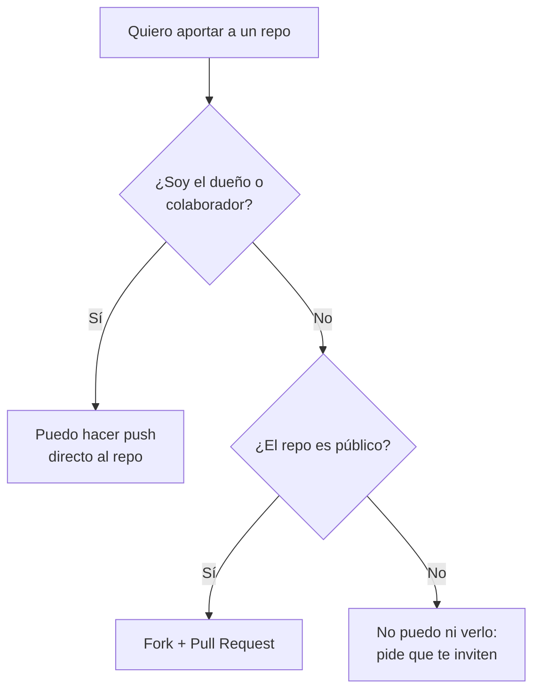
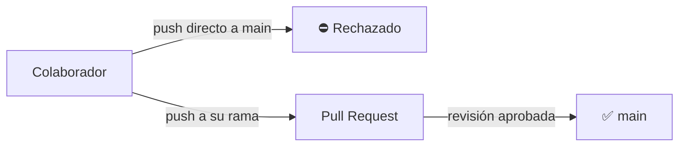

# 08 · Permisos: quién puede ver y modificar

**Objetivo:** controlar quién ve tu repositorio, quién puede cambiarlo y cómo
proteger la rama principal.

## 1. Visibilidad: público o privado

Es la primera decisión al crear un repo. Se cambia en **Settings → General →
Danger Zone → Change repository visibility**.

| | 🌍 Público | 🔒 Privado |
|---|---|---|
| ¿Quién lo ve? | Cualquier persona en internet | Solo tú y a quien invites |
| ¿Quién puede modificarlo? | Solo tú y tus colaboradores | Solo tú y tus colaboradores |
| ¿Se le puede hacer fork? | Sí, cualquiera | Solo quien tiene acceso |
| Úsalo para... | Portafolio, tareas abiertas, proyectos libres | Trabajos en proceso, proyectos de equipo cerrados |

> [!NOTE]
> Público significa que todos pueden **ver y copiar**, no que todos pueden
> **modificar**. Nadie puede escribir en tu repo si no le das permiso.

## 2. ¿Qué puede hacer cada quien?

En un repo de una **cuenta personal** solo hay dos niveles:

| Acción | Visitante (repo público) | Colaborador | Dueño |
|---|:-:|:-:|:-:|
| Ver y clonar | ✅ | ✅ | ✅ |
| Hacer fork y mandar Pull Request | ✅ | ✅ | ✅ |
| Abrir Issues | ✅ | ✅ | ✅ |
| Hacer `git push` al repo | ❌ | ✅ | ✅ |
| Aceptar Pull Requests | ❌ | ✅ | ✅ |
| Cambiar la configuración | ❌ | ❌ | ✅ |
| Invitar o quitar personas | ❌ | ❌ | ✅ |
| Borrar el repo | ❌ | ❌ | ✅ |

Por eso en el reto final no necesitas ningún permiso especial: con **fork y
Pull Request** cualquiera puede proponer cambios a un repo público.

## 3. Invitar a un colaborador

1. En tu repo: **Settings → Collaborators** (GitHub puede pedirte tu contraseña).
2. Clic en **Add people**.
3. Escribe el usuario o correo de la persona y selecciónala.
4. A esa persona le llega una invitación por correo: tiene que **aceptarla**
   para tener acceso.

Para quitar a alguien, en esa misma pantalla da clic en **Remove**.

> [!WARNING]
> Un colaborador puede subir y borrar código. Invita solo a personas de
> confianza y quita el acceso cuando termine el proyecto.

## 4. Roles en una organización

Cuando el repo pertenece a una **organización** (por ejemplo, la de una materia
o de un equipo), hay cinco roles para dar a cada quien solo lo necesario:

| Rol | Puede... | Ideal para |
|---|---|---|
| **Read** | Ver, clonar, abrir Issues y comentar | Alumnos que solo consultan |
| **Triage** | Lo anterior + organizar Issues y Pull Requests | Quien ayuda a ordenar pendientes |
| **Write** | Lo anterior + hacer push y aceptar Pull Requests | Integrantes del equipo |
| **Maintain** | Lo anterior + administrar el repo sin acciones peligrosas | Líder del equipo |
| **Admin** | Todo: configuración, permisos y borrar el repo | Profesor o responsable |

> [!TIP]
> **Principio de mínimo privilegio:** da siempre el permiso más bajo que le
> permita a la persona hacer su trabajo. Es la misma regla que se usa en
> ciberseguridad para cualquier sistema.

## 5. Proteger la rama `main`

Aunque alguien tenga permiso de escritura, puedes impedir que suba cambios
directo a `main` y obligar a que todo pase por un Pull Request:

1. **Settings → Branches → Add branch ruleset** (o **Add classic branch
   protection rule**, según lo que te muestre GitHub).
2. Ponle un nombre y, en la rama a proteger, indica `main`.
3. Activa **Require a pull request before merging**.
4. Si quieres, pide también al menos **1 aprobación** antes de unir.
5. Guarda.

> [!NOTE]
> Con una cuenta gratuita, la protección de ramas solo se aplica en repos
> **públicos**.

## 6. Permisos de tu computadora: llaves y tokens

GitHub también necesita saber que **tu computadora** tiene permiso de actuar a
tu nombre. Hay dos formas:

| | Llave SSH | Personal Access Token |
|---|---|---|
| ¿Qué es? | Un par de archivos que identifican a tu computadora | Una contraseña especial con permisos limitados |
| ¿Dónde se crea? | En tu terminal, con `ssh-keygen` | En GitHub: **Settings → Developer settings → Personal access tokens** |
| Se usa con direcciones... | `git@github.com:usuario/repo.git` | `https://github.com/usuario/repo.git` |
| Ventaja | La configuras una vez | Eliges qué repos y qué acciones permite, y cuándo caduca |

Al crear un token, dale **solo** los permisos que necesitas y ponle fecha de
vencimiento. Trátalo como una contraseña: no lo compartas ni lo subas a un repo.

## 7. Errores típicos de permisos

| Mensaje | Qué significa | Solución |
|---|---|---|
| `Permission denied (publickey)` | GitHub no reconoce tu llave SSH | Repite el paso 4 del [módulo 02](../02-instalacion/) |
| `remote: Permission to ... denied` / error `403` | Tu usuario no tiene permiso de escritura en ese repo | Pide que te agreguen como colaborador, o usa fork + Pull Request |
| `Repository not found` | El repo es privado y no tienes acceso, o la dirección está mal | Revisa la dirección con `git remote -v` y que hayas aceptado la invitación |
| `protected branch hook declined` o `push declined due to repository rule violations` | La rama está protegida | Sube tu cambio en otra rama y abre un Pull Request |

## ✏️ Ejercicio

Trabaja con un compañero:

1. Invítalo como **colaborador** a tu `mi-primer-repo`.
2. Que acepte la invitación, clone el repo y haga un `git push` directo.
   Comprueba que ahora sí puede.
3. **Protege la rama `main`** para exigir Pull Request.
4. Que tu compañero intente otro push directo a `main` y vea el rechazo.
5. Que lo suba en una rama y abra un Pull Request. Acéptalo tú.
6. Al terminar, **quítale el acceso**.

## ✅ Antes de continuar

- [ ] Sé la diferencia entre un repo público y uno privado
- [ ] Sé invitar y quitar colaboradores
- [ ] Conozco los cinco roles de una organización
- [ ] Sé proteger la rama `main`
- [ ] Reconozco los errores de permisos más comunes

---

[⬅️ Anterior: 07 · Git y GitHub juntos](../07-git-y-github-juntos/) · [🏠 Inicio](../README.md) · [Siguiente: 🏆 Reto final ➡️](../reto-final/)
