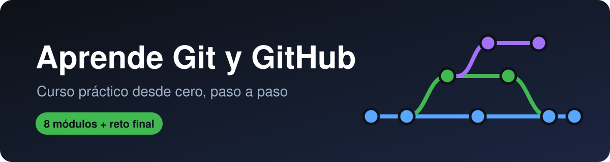
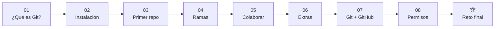
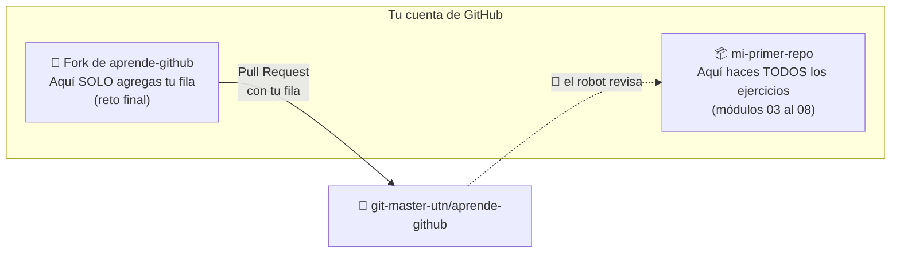
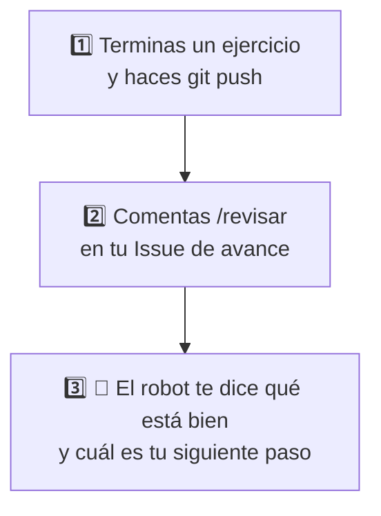

  

  
  
  
  

# 👋 Bienvenido

Este repositorio es un **curso práctico para aprender Git y GitHub desde cero**.
No necesitas saber nada antes de empezar: solo una computadora, internet y ganas.

La idea es sencilla: **aprendes GitHub usando GitHub**. Lees un módulo, haces el
ejercicio y al final mandas tu primer *Pull Request* a este mismo repositorio.

## 🗺️ Ruta de aprendizaje

|  | Módulo | Qué vas a aprender | Tiempo |
|:-:|---|---|:-:|
|  | [**01 · ¿Qué es Git?**](01-que-es-git/) | Para qué sirve el control de versiones y la diferencia entre Git y GitHub | 15 min |
|  | [**02 · Instalación**](02-instalacion/) | Instalar Git, crear tu cuenta y conectar tu computadora con GitHub | 30 min |
|  | [**03 · Tu primer repositorio**](03-primer-repo/) | `init`, `add`, `commit` y `push`: el ciclo básico de trabajo | 40 min |
|  | [**04 · Ramas**](04-ramas/) | Crear ramas, unirlas y resolver conflictos sin miedo | 40 min |
|  | [**05 · Colaborar**](05-colaborar/) | Fork, clone y Pull Request: cómo se trabaja en equipo | 40 min |
|  | [**06 · Extras**](06-extras/) | `.gitignore`, Issues, deshacer cambios y GitHub Pages | 30 min |
|  | [**07 · Git y GitHub juntos**](07-git-y-github-juntos/) | Cómo se sincronizan tu computadora y la nube, y el flujo completo de trabajo | 30 min |
|  | [**08 · Permisos**](08-permisos/) | Quién puede ver y modificar un repo: visibilidad, colaboradores, roles y protección de ramas | 30 min |
| 🏆 | [**Reto final**](reto-final/) | Agrega tu nombre a este repo con un Pull Request | 20 min |

## 🤖 Antes de empezar: un robot revisa tu trabajo

Este curso **no se aprueba solo con el último paso**. Cuando mandas tu Pull Request
del [reto final](reto-final/), un robot revisa tu repositorio de práctica y comprueba
que hiciste los ejercicios de **cada módulo**. Te deja un comentario con ✅ lo que
cumpliste y ❌ lo que te falta.

Para que no te marque error, ten claros **tus dos repositorios**:

> [!IMPORTANT]
> **Las 3 reglas para que el robot te apruebe:**
> 1. Crea en **tu** cuenta un repo **público** llamado **exactamente** `mi-primer-repo` y haz ahí los ejercicios.
> 2. **No hagas los ejercicios dentro del fork del curso.** El fork es solo para agregar tu fila.
> 3. Al final de cada módulo hay una caja **"🔎 Evidencia para el reto final"**: cúmplela antes de seguir.

> [!TIP]
> ¿El robot te marcó algo en rojo? **No es que esté descompuesto:** te está diciendo
> exactamente qué te falta. Lee la tabla
> [Si el robot marca algo en rojo](reto-final/#si-el-robot-marca-algo-en-rojo),
> arréglalo y pide otra revisión.

## 📈 Revisa tu avance en cualquier momento

No tienes que esperar al final para saber si vas bien. Cuando termines un
ejercicio y hagas `git push`:

1. Abre el Issue **[📈 Revisar mi avance](https://github.com/git-master-utn/aprende-github/issues/new?template=revisar-avance.md&title=Revisar+mi+avance)** y da clic en **Create** (o *Submit new issue*).
2. En un minuto el robot te contesta con tu **calificación hasta ahora**, una
   tabla de lo que ya está bien ✅ y lo que falta ❌, y **tu siguiente paso**.
3. Cada vez que termines otro ejercicio, escribe en **ese mismo Issue** un
   comentario que diga `/revisar` y el robot vuelve a revisar.

> [!NOTE]
> Abre **un solo** Issue de avance y úsalo todo el curso. Para entregar, al final
> haz el [reto final](reto-final/).

## 🚀 ¿Cómo usar este repo?

1. Sigue los módulos **en orden**; cada uno usa lo del anterior.
2. **Escribe los comandos tú mismo**. Copiar y pegar sirve, pero teclear enseña más.
3. Haz el **ejercicio** al final de cada módulo antes de pasar al siguiente.
4. Ten a la mano el [**cheatsheet**](cheatsheet.md) con todos los comandos en una página.
5. Termina con el [**reto final**](reto-final/): el robot revisa que hayas hecho todo.

> [!TIP]
> Si algo sale mal, no pasa nada. Git casi nunca pierde tu trabajo y equivocarse
> es la forma más rápida de aprenderlo.

## 📎 Material de apoyo

- Dirección de este repositorio: <https://github.com/git-master-utn/aprende-github>

- [Cheatsheet de comandos](cheatsheet.md)
- [Lista de alumnos que completaron el reto](reto-final/alumnos.md)

## 🙌 Créditos

<!-- Logo de la UTN: guarda el archivo como img/logo-utn.png y quita los signos de comentario de la línea de abajo -->
<!--  -->

Elaborado por [**Luis Ángel Pérez González**](https://github.com/luisperezglz) como parte de su servicio social en la
División Académica de Telemática de la **Universidad Tecnológica de Nezahualcóyotl**.

Puedes usar y adaptar este material libremente para dar clases.
