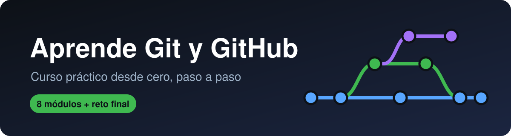
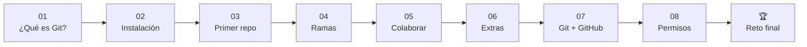

  

  
  
  
  

# 👋 Bienvenido

Este repositorio es un **curso práctico para aprender Git y GitHub desde cero**.
No necesitas saber nada antes de empezar: solo una computadora, internet y ganas.

La idea es sencilla: **aprendes GitHub usando GitHub**. Lees un módulo, haces el
ejercicio y al final mandas tu primer *Pull Request* a este mismo repositorio.

## 🗺️ Ruta de aprendizaje

|  | Módulo | Qué vas a aprender | Tiempo |
|:-:|---|---|:-:|
|  | [**01 · ¿Qué es Git?**](01-que-es-git/) | Para qué sirve el control de versiones y la diferencia entre Git y GitHub | 15 min |
|  | [**02 · Instalación**](02-instalacion/) | Instalar Git, crear tu cuenta y conectar tu computadora con GitHub | 30 min |
|  | [**03 · Tu primer repositorio**](03-primer-repo/) | `init`, `add`, `commit` y `push`: el ciclo básico de trabajo | 40 min |
|  | [**04 · Ramas**](04-ramas/) | Crear ramas, unirlas y resolver conflictos sin miedo | 40 min |
|  | [**05 · Colaborar**](05-colaborar/) | Fork, clone y Pull Request: cómo se trabaja en equipo | 40 min |
|  | [**06 · Extras**](06-extras/) | `.gitignore`, Issues, deshacer cambios y GitHub Pages | 30 min |
|  | [**07 · Git y GitHub juntos**](07-git-y-github-juntos/) | Cómo se sincronizan tu computadora y la nube, y el flujo completo de trabajo | 30 min |
|  | [**08 · Permisos**](08-permisos/) | Quién puede ver y modificar un repo: visibilidad, colaboradores, roles y protección de ramas | 30 min |
| 🏆 | [**Reto final**](reto-final/) | Agrega tu nombre a este repo con un Pull Request | 20 min |

## 🚀 ¿Cómo usar este repo?

1. Sigue los módulos **en orden**; cada uno usa lo del anterior.
2. **Escribe los comandos tú mismo**. Copiar y pegar sirve, pero teclear enseña más.
3. Haz el **ejercicio** al final de cada módulo antes de pasar al siguiente.
4. Ten a la mano el [**cheatsheet**](cheatsheet.md) con todos los comandos en una página.
5. Termina con el [**reto final**](reto-final/) para dejar tu nombre aquí.

> [!TIP]
> Si algo sale mal, no pasa nada. Git casi nunca pierde tu trabajo y equivocarse
> es la forma más rápida de aprenderlo.

## 📎 Material de apoyo

- Dirección de este repositorio: <https://github.com/git-master-utn/aprende-github>

- [Cheatsheet de comandos](cheatsheet.md)
- [Lista de alumnos que completaron el reto](reto-final/alumnos.md)

## 🙌 Créditos

<!-- Logo de la UTN: guarda el archivo como img/logo-utn.png y quita los signos de comentario de la línea de abajo -->
<!--  -->

Elaborado por **Luis Angel Perez Gonzalez** como parte de su servicio social en la
División Académica de Telemática de la **Universidad Tecnológica de Nezahualcóyotl**.

Puedes usar y adaptar este material libremente para dar clases.
