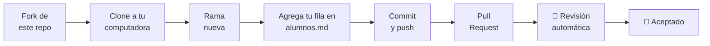

# 🏆 Reto final

**Objetivo:** demostrar que completaste **todo el curso**. Tu Pull Request solo
se acepta si tu repositorio de práctica tiene la evidencia de cada módulo.

> [!IMPORTANT]
> Haz este reto **al final**, cuando ya hayas terminado los ejercicios de los
> módulos 02 al 08. Un robot revisa tu repositorio de práctica automáticamente:
> si te saltaste algo, te lo va a decir.

## ✅ Requisitos antes de empezar

Todo se revisa en **tu** repositorio `mi-primer-repo` (el que creaste en el
módulo 03). Debe ser **público** y llamarse **exactamente** `mi-primer-repo`.

| Módulo | Evidencia que se revisa | Puntos |
|:-:|---|:-:|
| [02](../02-instalacion/) | Tus commits aparecen ligados a tu cuenta (configuraste el correo correcto) | 0.5 |
| [03](../03-primer-repo/) | El repo tiene `README.md` y al menos 3 commits | 1 |
| [04](../04-ramas/) | Hay una unión de ramas hecha en tu computadora (el ejercicio del conflicto) | 2 |
| [05](../05-colaborar/) | Aceptaste un Pull Request de un compañero | 2 |
| [06](../06-extras/) | Tiene un `.gitignore` que ignora archivos `.log` | 0.5 |
| [06](../06-extras/) | Tiene al menos un Issue | 0.5 |
| [07](../07-git-y-github-juntos/) | Hiciste `git pull` para unir un cambio que hiciste desde la página de GitHub | 2 |
| [08](../08-permisos/) | La rama `main` está protegida | 1.5 |
| | **Total** | **10** |

Los ejercicios más difíciles (conflictos, colaborar y sincronizar) valen más.

El módulo 01 es teórico y se evalúa en clase.

## Pasos



**1. Haz fork** del repositorio original, [git-master-utn/aprende-github](https://github.com/git-master-utn/aprende-github), con el botón **Fork** de arriba a la derecha.

**2. Clona tu fork** (cambia `TU-USUARIO` por tu usuario de GitHub):

```bash
git clone git@github.com:TU-USUARIO/aprende-github.git
cd aprende-github
```

**3. Crea una rama:**

```bash
git switch -c agrega-tu-nombre
```

**4. Edita** [`reto-final/alumnos.md`](alumnos.md) y agrega **una fila al final
de la tabla** con tus datos, siguiendo el formato del ejemplo. El usuario de la
fila debe ser **el tuyo**.

**5. Guarda y sube tu cambio:**

```bash
git add reto-final/alumnos.md
git commit -m "Agrego a Tu Nombre a la lista de alumnos"
git push -u origin agrega-tu-nombre
```

**6. Abre el Pull Request** desde tu fork con el botón **Compare & pull request**.
En el título escribe `Reto final: Tu Nombre` y llena la lista de la descripción.

## 🤖 ¿Qué pasa después?

En un minuto aparece un **comentario automático** en tu Pull Request con una
tabla: ✅ lo que ya cumpliste y ❌ lo que te falta.

- Si todo sale en ✅ (10 / 10), el robot **te agrega solo a la [lista de alumnos](alumnos.md)** y cierra tu Pull Request con un mensaje de felicitación. Que se cierre es normal: tu fila ya quedó en la lista.
- Si algo sale en ❌, ve al módulo indicado, haz el ejercicio en tu
  `mi-primer-repo` y después **edita la descripción de tu Pull Request**
  (basta con agregar un espacio y guardar). El robot vuelve a revisar y
  actualiza su comentario.

## Si el robot marca algo en rojo

El robot no se equivoca a propósito: cada ❌ tiene una causa. Busca tu mensaje aquí.

| El robot dice... | Por qué pasa | Cómo se arregla |
|---|---|---|
| Repo público `TU-USUARIO/mi-primer-repo`: **No existe, es privado o tiene otro nombre** | No creaste el repo, le pusiste otro nombre, es privado o lo hiciste con otra cuenta | Entra a `github.com/TU-USUARIO?tab=repositories`. Si tiene otro nombre: **Settings → Repository name** → `mi-primer-repo`. Si es privado: **Settings → Change visibility → Public**. Si no existe, haz el [módulo 03](../03-primer-repo/) |
| **Solo debes modificar `reto-final/alumnos.md`** | Hiciste los ejercicios dentro de tu fork del curso, o editaste otros archivos | Cierra tu PR, borra tu fork (**Settings** → hasta abajo → **Delete this repository**), haz los ejercicios en tu `mi-primer-repo` y vuelve a hacer el reto desde un fork nuevo |
| **Debes agregar exactamente una fila** | Agregaste más de una fila, o tu PR trae la fila de otra persona | Cada quien manda su propio PR desde su propia cuenta con **una sola** fila |
| **No borres ni cambies las filas de tus compañeros** | Modificaste o borraste filas que ya estaban | Deja la tabla como estaba y agrega tu fila **al final** |
| **El usuario de tu fila debe ser el tuyo** | Escribiste mal tu usuario o pusiste el de otra persona | Corrige el usuario en tu fila: debe ser el de la cuenta que mandó el PR |
| **Tu fila debe tener las 4 columnas llenas** | Te faltó el nombre, el usuario, el grupo o la fecha | Llena las 4 columnas siguiendo el ejemplo |
| ❌ en **02** · Commits ligados a tu cuenta | El correo de `git config` no es el de tu cuenta de GitHub | Revisa el [módulo 02](../02-instalacion/), corrige el correo y haz un commit nuevo con `git push` |
| ❌ en **03** · README y 3 commits | Tu repo tiene menos de 3 commits o no tiene `README.md` | Haz el ejercicio del [módulo 03](../03-primer-repo/) |
| ❌ en **04** · Unión de ramas | No hiciste el ejercicio del conflicto, o no lo subiste | Haz el ejercicio del [módulo 04](../04-ramas/) y termina con `git push` |
| ❌ en **05** · Pull Request de un compañero | Nadie te mandó un PR, o no lo aceptaste | Pide a un compañero que te mande uno y dale **Merge** ([módulo 05](../05-colaborar/)) |
| ❌ en **06** · `.gitignore` o Issue | Falta el `.gitignore` con `*.log` o no creaste ningún Issue | Haz el ejercicio del [módulo 06](../06-extras/) |
| ❌ en **07** · `git pull` | No editaste en GitHub y luego hiciste `git pull` en tu compu | Haz el ejercicio del [módulo 07](../07-git-y-github-juntos/) y termina con `git push` |
| ❌ en **08** · Rama protegida | No protegiste la rama `main` de tu `mi-primer-repo` | Sigue el paso 5 del [módulo 08](../08-permisos/) |


**Otros problemas comunes:** si el PR se fue a tu propio repo, sale *Review required*,
hay conflictos o te dice que no puedes aprobar tu propio PR, revisa la tabla
*Problemas comunes* del [módulo 05](../05-colaborar/). Si la tabla del robot se ve
desacomodada, desactiva la traducción del navegador.

**Cuando lo arregles,** edita la descripción de tu Pull Request (agrega un espacio
y guarda) para que el robot vuelva a revisar. **No abras otro PR.**

> [!NOTE]
> Si ya revisaste todo y estás seguro de que el robot se equivoca, abre un
> [Issue](https://github.com/git-master-utn/aprende-github/issues/new) con el
> enlace a tu Pull Request y una captura.

## Reglas

- Solo modifica `reto-final/alumnos.md`.
- Agrega **una sola fila** y no borres las de tus compañeros.
- Usa tu propio usuario en la fila.

> [!TIP]
> Si GitHub dice que tu PR tiene **conflictos**, es porque alguien más agregó su
> fila antes que tú. Usa **Sync fork** en tu fork, luego en tu computadora
> ejecuta `git switch main`, `git pull`, `git switch agrega-tu-nombre` y
> `git merge main`. Resuelve el conflicto como en el
> [módulo 04](../04-ramas/) y vuelve a hacer `git push`.

>
> git clone git@github.com:MiguelS-cryto/aprende-github.git
> cd aprende-github
> git switch -c MiguelS-cryto
> git add reto-final/alumnos.md
> git commit -m "MiguelS-cryto"
> git push -u origin MiguelS-cryto
---

[⬅️ Anterior: 08 · Permisos](../08-permisos/) · [🏠 Inicio](../README.md)
