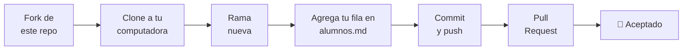

# 🏆 Reto final

**Objetivo:** demostrar todo lo que aprendiste dejando tu nombre en este
repositorio por medio de un **Pull Request**.



## Pasos

**1. Haz fork** del repositorio original, [git-master-utn/aprende-github](https://github.com/git-master-utn/aprende-github), con el botón **Fork** de arriba a la derecha.

**2. Clona tu fork** (cambia `TU-USUARIO` por tu usuario de GitHub):

```bash
git clone git@github.com:TU-USUARIO/aprende-github.git
cd aprende-github
```

**3. Crea una rama con tu nombre:**

```bash
git switch -c agrega-tu-nombre
```

**4. Edita el archivo** [`reto-final/alumnos.md`](alumnos.md) y agrega **una fila
al final de la tabla** con tus datos, siguiendo el formato del ejemplo.

**5. Guarda y sube tu cambio:**

```bash
git add reto-final/alumnos.md
git commit -m "Agrego a Tu Nombre a la lista de alumnos"
git push -u origin agrega-tu-nombre
```

**6. Abre el Pull Request** desde tu fork con el botón **Compare & pull request**.
En el título escribe: `Reto final: Tu Nombre`.

## Reglas

- Solo modifica `reto-final/alumnos.md`.
- Agrega **una sola fila** y no borres las de tus compañeros.
- Usa un mensaje de commit claro.

> [!TIP]
> Si GitHub dice que tu PR tiene **conflictos**, es porque alguien más agregó su
> fila antes que tú. Usa **Sync fork** en tu fork, luego en tu computadora
> ejecuta `git switch main`, `git pull`, `git switch agrega-tu-nombre` y
> `git merge main`. Resuelve el conflicto como en el
> [módulo 04](../04-ramas/) y vuelve a hacer `git push`.

## Lo que demuestras con este reto

- [ ] Fork y clone
- [ ] Ramas
- [ ] add, commit y push
- [ ] Pull Request
- [ ] (Tal vez) resolver un conflicto real

---

[⬅️ Anterior: 08 · Permisos](../08-permisos/) · [🏠 Inicio](../README.md)
